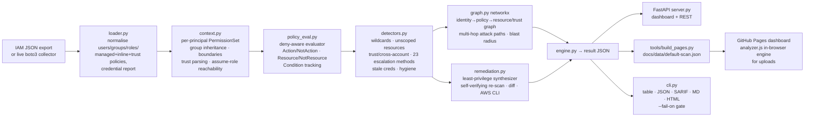

# IAM Sentinel — Cloud Identity & Excessive IAM Permission Detection (PS-07)

IAM Sentinel reads an AWS IAM export. It finds **excessive permissions, risky trust relationships, privilege-escalation chains and dormant identities**, turns them into an **attack graph with blast-radius scores**, and generates a **verified least-privilege policy and the AWS CLI commands to apply it** for every finding.

It runs in three modes from one codebase:

* **Web dashboard**: an interactive attack graph, an evidence drawer, side-by-side policy diffs and one-click report export.
* **Zero-backend hosted dashboard**: the same UI on GitHub Pages at **https://farah-adam.github.io/IAM-Sentinel/**. Samples are pre-computed, and uploaded files are analysed by an in-browser engine. Nothing leaves the browser.
* **CLI / CI-CD gate**: `--fail-on HIGH` returns non-zero exit codes and writes SARIF, JSON, Markdown or HTML.

---

## ⏱ 60-second quickstart

```bash
pip install -r requirements.txt        # Python 3.10+  (fastapi, uvicorn, networkx, python-multipart)
python main.py                         # → http://127.0.0.1:8000  (auto-loads ./iam-small.json)
```

or `./run.sh` (Linux/macOS) / `run.bat` (Windows). These install dependencies, print the CLI summary and start the dashboard.

```bash
python cli.py scan iam-small.json                               # coloured console summary
python cli.py scan iam-small.json --fail-on HIGH                # CI gate → exit 1 (this dataset is vulnerable)
python cli.py scan iam-small.json -f sarif -o iam.sarif         # GitHub code scanning
python cli.py scan iam-small.json -f html -o report.html --also md=report.md --also json=findings.json
python cli.py scan iam-small.json --write-remediations remediation/   # fixed JSON policies + apply.sh
python cli.py serve --file my-export.json --port 9000           # dashboard on another export
python cli.py collect --profile audit -o export.json            # live read-only AWS snapshot (boto3)
python -m pytest -q                                             # 54 tests (incl. browser-engine parity)
python tools/build_pages.py                                     # rebuild the GitHub Pages site in docs/
```

Exit codes: `0` = pass, `1` = findings at or above `--fail-on`, `2` = bad input or usage. A ready-made GitHub Actions gate is in `.github/workflows/iam-sentinel.yml`.

**Inputs accepted** (CLI, upload button or drag-and-drop anywhere on the dashboard):
* `aws iam get-account-authorization-details` output, including URL-encoded documents from the raw API
* plus an optional `CredentialReport` (CSV string, base64 `Content` or a list of rows) and an optional `list-users` `Users` array
* or a single bare policy document, which is linted as an inline policy

The dashboard's JS libraries (Tailwind, Cytoscape.js) are **vendored in `static/vendor/`**, so the demo works offline.

### 🌐 GitHub Pages (no server)

`docs/` is a fully static build of the dashboard:

```bash
python tools/build_pages.py      # regenerate static/catalog.js, copy the dashboard to docs/, pre-compute scans
```

* **On load** the dashboard reads `./data/default-scan.json`. This holds the full Python-engine analysis of `iam-small.json` and `samples/iam-multihop-demo.json`: graph, posture grade, findings, blast radius and remediation diffs. The page is fully interactive immediately.
* **Uploads and drag-and-drop** run `analyzer.js`, a dependency-free JavaScript port of the engine. It covers deny-aware evaluation, all detectors, the attack graph, blast radius, the self-verifying least-privilege synthesizer and the HTML/MD/JSON/SARIF exporters. The file is analysed locally and is never uploaded anywhere.
* **The two engines agree exactly.** `tests/test_pages.py` runs the browser engine under Node and asserts its output matches the Python engine field for field on both datasets, including findings, paths, blast radius, proposed policies, diffs and generated ExternalIds. It also checks that `docs/` is in sync with `static/`.
* **Mode detection:** `docs/index.html` carries `<meta name="iam-sentinel-mode" content="static">`. Served by `python main.py`, the same `app.js` finds the API and uses it instead. A header pill shows which mode is active.
* **Relative paths:** every asset and data URL is relative (`./app.js`, `./vendor/…`, `data/…`), so it works under the `/IAM-Sentinel/` sub-path.

To publish: push the repo to `github.com/farah-adam/IAM-Sentinel`. Then, under **Settings → Pages → Build and deployment**, choose *Deploy from a branch*, `main`, folder `/docs`. `docs/.nojekyll` disables Jekyll processing.

---

## 🏗 Architecture



```
iam-small.json            target dataset (auto-loaded)
samples/iam-multihop-demo.json   synthetic account showing multi-hop/cross-account/OIDC/deny/stale scenarios
iamsentinel/
  catalog.py      knowledge base: 120+ sensitive actions, 23 escalation methods, managed-policy docs, MITRE ATT&CK map
  loader.py       ingestion + normalisation       policy_eval.py   deny-aware evaluator
  context.py      effective permissions & trust    detectors.py     rule engine
  graph.py        attack graph, paths, blast radius remediation.py  least-privilege synthesizer
  reports.py      JSON / SARIF / Markdown / HTML   engine.py        orchestration + posture grade
  server.py       FastAPI API + dashboard          collector.py     optional live AWS collector
static/           dashboard (index.html, app.js, app.css, vendor/)
  analyzer.js     in-browser engine: JavaScript port of iamsentinel/ (same result schema)
  catalog.js      GENERATED from catalog.py by tools/build_pages.py (shared knowledge base)
docs/             GitHub Pages build (static copy + data/default-scan.json) - generated, do not edit
tools/            build_pages.py (Pages build) · js_analyze.js (run the browser engine under Node)
tests/            pytest suite (evaluator, every iam-small flaw, trust, privesc, stale, remediation, CLI, API)
reports/          pre-generated reports + remediation/ (JSON policies + apply.sh) for iam-small.json
```

**REST API:**

| Endpoint | Returns |
|---|---|
| `GET /api/analysis?sample=default\|multihop` | analysis of a built-in sample |
| `POST /api/analyze` (multipart `file`) | analysis of an uploaded export |
| `GET /api/report/{analysis_id}.{html\|md\|json\|sarif}` | that analysis as a report |
| `GET /api/health` | server status |

---

## 🔍 What `./iam-small.json` contains

**Schema:** `GetAccountAuthorizationDetails` for account **182102543085**.

| Element | Count | Contents |
|---|---|---|
| `UserDetailList` | 3 | `test-admin`, `test-passrole`, `test-s3-all`. All created 2026-11-17, with no groups, no MFA or credential data, and no `PasswordLastUsed` |
| `GroupDetailList` | 0 | — |
| `RoleDetailList` | 2 | `connct-with-ssm`: EC2 trust, instance profile, last used 2026-10-25.<br>`ec2-console-devops-agent-us-east-1`: `/service-role/`, `aidevops.amazonaws.com` trust with `aws:SourceAccount` + `aws:SourceArn`, last used 2026-10-20 |
| `Policies` | 3 | AWS managed: `AdministratorAccess`, `AmazonSSMManagedInstanceCore`, and `AIDevOpsAgentAccessPolicy` (989 actions across 190 services) |
| Inline policies | 2 | `ci-deploy`: `iam:PassRole` + `lambda:CreateFunction` on `*`.<br>`s3-all`: `s3:*` on `*` |

### Findings: grade F (39/100), 14 findings, 1 critical attack path, 50% excess-permission ratio

| Severity | Rule | Identity | Evidence | Why it matters |
|---|---|---|---|---|
| **CRITICAL** | ADMIN-001 | test-admin | `AdministratorAccess` · Statement[0] · `Action:*` `Resource:*` | Full account takeover from one leaked password or key |
| HIGH | HYG-003 | test-admin | IAM user with admin | Long-lived credentials and no role/MFA gating |
| HIGH | PRIV-015 | test-passrole | `ci-deploy` · `iam:PassRole` + `lambda:CreateFunction` on `*` | Toxic combination: create a function that runs with any passable role. Reported as **latent**: no role in the export trusts `lambda.amazonaws.com`, and there is no `lambda:InvokeFunction`. It becomes exploitable the moment one exists. |
| HIGH | RES-001 | test-passrole | same statement | PassRole and code-execution APIs unscoped |
| HIGH | WILD-002 | test-s3-all | `s3-all` · `s3:*` on `*` | Read, exfiltrate, make public (`PutBucketPolicy`) and delete every bucket |
| MEDIUM ×3 | HYG-002 | all 3 users | `CreateDate` < 24 h | Newly created privileged users are a classic persistence technique (T1136.003); verify in CloudTrail |
| MEDIUM | RES-001 | connct-with-ssm | `AmazonSSMManagedInstanceCore` · `ssm:GetParameter(s)` on `*` | Any process on the instance can read every SSM parameter |
| MEDIUM | RES-001 | ec2-console-devops-agent | `AIDevOpsAgentAccessPolicy/AIOPSServiceAccess` | Log-data reads, `eks:AccessKubernetesApi`, `cloudformation:GetTemplate` on `*` |
| LOW | READ-001 | ec2-console-devops-agent | 989 actions / 190 services on `*` | Account-wide reconnaissance surface |
| LOW ×2 | HYG-001 | test-passrole, test-s3-all | inline user policies | Invisible to policy inventories |
| INFO | TELEM-001 | 3 users | no credential report | User dormancy **cannot** be assessed and is reported as such, not guessed |

**Not flagged (correctly):**
* Both trust policies are safe. The AIDevOps trust's confused-deputy conditions are recorded as a **positive control**.
* Both roles were used within the last 90 days.
* No cross-account or wildcard principals exist in this dataset.

**Blast radius:**

| Identity | Score |
|---|---|
| test-admin | 100 |
| test-s3-all | 59 |
| test-passrole | 57 |
| ec2-console-devops-agent | 34 |
| connct-with-ssm | 24 |

Full reports are in `reports/iam-small-report.html` / `.md` / `.sarif` / `-findings.json`, and the fixed policies are in `reports/remediation/`.

---

## 🧠 Detection engine

### Deny-aware effective permission evaluation (`policy_eval.py`)
* `*` / `?` wildcards. Actions are matched case-insensitively and ARNs case-sensitively.
* `Action` and `NotAction`, `Resource` and `NotResource`.
* **Explicit Deny wins.**
  * An unconditional Deny fully suppresses a finding, and the suppression is recorded as a respected guardrail.
  * A conditional Deny is tracked as a guardrail that *may* block.
  * A Deny on only some resources does not block account-wide access.
* **Permissions boundaries** are intersected with identity policies.
* Group-inherited statements are attributed with `via group:<name>`.
* Conditional Allows with meaningful keys lower severity by one level and are marked `conditional`. Meaningful keys are MFA, `aws:PrincipalOrgID`, `aws:SourceIp`, `aws:SourceVpc`, `sts:ExternalId`, `aws:ResourceAccount` and `iam:PassedToService`.

### Rules

| Family | Rules |
|---|---|
| Excessive privilege | **ADMIN-001** `*` on `*`<br>**ADMIN-002** broad AWS managed policies (PowerUserAccess, IAMFullAccess, AmazonS3FullAccess …)<br>**READ-001** very broad surface |
| Wildcards | **WILD-001** `*` on scoped resources<br>**WILD-002** `svc:*`, rated by service criticality<br>**WILD-003** verb wildcards (`iam:Put*`) that expand to sensitive APIs<br>**WILD-004** Allow + NotAction<br>**WILD-005** Allow + NotResource |
| Unscoped resources | **RES-001** sensitive actions (privesc, credential access, code execution, defense evasion, destruction, data) on `Resource:*` |
| Trust / cross-account | **TRUST-001** `Principal:*`<br>**TRUST-002** external account without `sts:ExternalId`<br>**TRUST-003** external account with ExternalId (review)<br>**TRUST-004** own-account root trust<br>**TRUST-005** OIDC/SAML/Cognito federation without `sub`/`aud` pinning (GitHub, GitLab, Terraform Cloud)<br>**TRUST-006** service trust without `aws:SourceAccount`/`SourceArn`<br>**TRUST-007** Allow + NotPrincipal |
| Privilege escalation | **PRIV-001…023**:<br>CreatePolicyVersion, SetDefaultPolicyVersion, Attach/Put User/Group/Role policy, AddUserToGroup, CreateAccessKey, Create/UpdateLoginProfile, UpdateAssumeRolePolicy, PassRole + EC2/Lambda/Glue/CloudFormation/ECS/SageMaker/CodeBuild, UpdateFunctionCode, SSM SendCommand/StartSession, permissions-boundary removal |
| Attack paths | **PATH-001** multi-hop chains found by graph traversal |
| Stale / unused | **STALE-001** role unused or never used<br>**STALE-002** console password unused<br>**STALE-003** access key unused or never used<br>**STALE-004** console user without MFA<br>**STALE-005** key not rotated<br>**TELEM-001** telemetry absent |
| Hygiene / persistence | **HYG-001** inline user policies<br>**HYG-002** recently created privileged identity<br>**HYG-003** admin as a long-lived IAM user |

### Privilege-escalation severity
Escalations are rated by context, not just by pattern. For PassRole methods, IAM Sentinel checks which roles in the export can actually be passed (the PassRole resource matches **and** the role trusts the target service):

| Situation | Severity |
|---|---|
| A passable role is admin | CRITICAL (confirmed) |
| Passable roles exist but none is admin | HIGH |
| No passable role exists yet | HIGH (**latent**) |
| A trigger permission is missing (e.g. no `lambda:InvokeFunction`) | **latent**, with a "one permission away" note |

Every finding carries **MITRE ATT&CK** technique IDs.

---

## 💡 Innovation

### 1. Multi-hop attack path discovery (networkx)
The graph has these nodes and edges:
* **Nodes:** users, groups, roles, policies, resources (per service and ARN scope), trust principals (services, external accounts, federated IdPs, `*`), escalation primitives, and **FULL ACCOUNT CONTROL**.
* **Edges:** `member_of`, `has_policy`, `grants`, `trusts`, `can_assume` (trust **and** identity policy both evaluated), `escalates`, and `DENIED` for grants neutralised by Deny, which are drawn but not traversable.

From every entry point (user, external account, IdP, `*`, AWS service), the engine finds the shortest route to:
* full control,
* each sensitive grant,
* latent escalation primitives.

The demo dataset includes this path:
`GitHub OIDC (no sub) → github-actions-deploy → sts:AssumeRole → deploy-pipeline → iam:CreatePolicyVersion → FULL ACCOUNT CONTROL`

### 2. Identity blast radius (0–100, explainable)
The score is the sum of the factors below, capped at 100. Each factor is shown in the inspector.

| Factor | Points |
|---|---|
| Administrator | 80 direct / 75 via a path |
| Otherwise, sensitive capability categories reachable (own policies + assumable roles, deny-aware) | up to 50 |
| Breadth of sensitive services | up to 10 |
| Escalation primitive | 12 confirmed / 8 latent |
| Cross-account exposure | `*` 20 · external without ExternalId or weak OIDC 15 · ExternalId 5 |
| Long-lived user credentials | 5 |
| Wildcard resource scope | 10 |
| Hygiene (new privileged / dormant) | 5 |

Levels: ≥80 Critical, ≥55 High, ≥30 Medium, otherwise Low.

### 3. Self-verifying least-privilege synthesizer
For each flagged policy, the synthesizer rewrites statement by statement:

| Original | Replacement |
|---|---|
| `*` (human user) | MFA-gated admin (`aws:MultiFactorAuthPresent` + `MultiFactorAuthAge`) + an explicit Deny protecting CloudTrail, GuardDuty, Config, Security Hub and Access Analyzer |
| `svc:*` | curated day-to-day actions, scoped to ARN templates |
| Sensitive actions on `*` | split into a list-only `*` statement + a scoped statement with an `aws:ResourceAccount` guardrail |
| `iam:PassRole` | a single role ARN + `iam:PassedToService`, inferred from the identity's own compute actions |
| Verb wildcards | kept, plus an explicit Deny of their sensitive expansions |
| Trust policies | `aws:PrincipalOrgID`, a deterministic `sts:ExternalId`, OIDC `sub`/`aud` pinning, `aws:SourceAccount` |

It then **re-runs the detectors on its own output** and reports the residual risk (e.g. `HIGH → NONE ✓`). It also lists every `<PLACEHOLDER>` to fill in and emits a side-by-side diff plus AWS CLI commands:

| Policy type | CLI commands |
|---|---|
| Inline | `put-*-policy` |
| Customer-managed | `create-policy-version --set-as-default` |
| AWS-managed | `create-policy` + `attach` + `detach` |
| Trust | `update-assume-role-policy` |

All commands are preceded by `aws accessanalyzer validate-policy`. The generated `apply.sh` **refuses to run while placeholders remain**.

---

## 🖥 Dashboard tour (demo script)

1. **Posture banner.** Shows the grade A–F, total identities, critical attack paths, excess-permission ratio, findings by severity and max blast radius. A telemetry warning appears when usage data is missing.
2. **Attack Graph.** The layout is tiered: Principals → Users → Groups → Roles → Policies → Escalation → Resources → Full Control.
   * Colours: red = critical/admin, orange = cross-account/warning, blue = identity, green = resource.
   * **Highlight Attack Paths** dims everything else and animates the toxic chains.
   * Click a path card to isolate one chain. Click any node to see effective permissions (deny-aware), its blast-radius gauge with factor breakdown, trust relationships and findings.
3. **Findings.** Filter by severity, category and exploitability, or search. Click a row to open the **evidence drawer**: identity ARN, policy name/ARN/kind, Sid, Effect, highlighted offending actions, Resource, Condition, risk explanation, attack path, MITRE tags, and the **Original vs. least-privilege diff**, which you can copy or download.
4. **Identities & Blast Radius.** Identity cards ranked by score.
5. **Least-Privilege Fixes.** Every generated policy, with its verification badge, diff and CLI.
6. **Export.** HTML executive + technical report, Markdown, JSON, SARIF, or `apply-remediations.sh`.

Click **Multi-hop demo** to show cross-account, OIDC, `Principal:*`, group → assume → escalate chains, the Deny guardrail being respected, and stale credentials.

**Deep links** for presenting:

| Link | Opens |
|---|---|
| `/?sample=multihop&path=PATH-002` | one attack path isolated |
| `/?finding=F-001` | a finding's evidence drawer |
| `/?tab=remediation` | the fixes tab |
| `/?hl=1` | attack-path highlighting on |

---

## 🔐 Live AWS mode: minimum read-only permissions

```json
{
  "Version": "2012-10-17",
  "Statement": [{
    "Sid": "IamSentinelReadOnly",
    "Effect": "Allow",
    "Action": [
      "iam:GetAccountAuthorizationDetails",
      "iam:GenerateCredentialReport",
      "iam:GetCredentialReport"
    ],
    "Resource": "*"
  }]
}
```

* `sts:GetCallerIdentity` is used only to print the scanned account and needs no permission.
* `iam:GenerateCredentialReport` only triggers report generation and changes no access.
* The AWS managed `SecurityAudit` policy also covers all of the above.

```bash
pip install boto3
python cli.py collect --profile <audit-profile> -o export.json && python cli.py scan export.json
```

The collector keeps only the AWS-managed policies that are actually attached. Without a credential report, user dormancy checks are reported as *telemetry absent* rather than guessed.

---

## 📐 Assumptions

* **Static analysis of one account snapshot.** "Now" is the analysis time and the stale threshold is 90 days (`--stale-days`).
* **Statement-level findings.** Findings on a managed policy are reported once per policy statement and list every affected identity. Deny-awareness is evaluated for each holder.
* **AWS-managed policies are vendor-maintained.**
  * Their findings are lowered one level, and the fix is a customer-managed replacement.
  * If an export references a well-known AWS policy without its document, the document is reconstructed from the built-in knowledge base and marked `synthesized`. This covers AdministratorAccess, PowerUserAccess, IAMFullAccess, AmazonS3FullAccess, ReadOnlyAccess and AmazonEC2FullAccess.
* **Posture grade:** start at 100, then subtract CRITICAL 15 / HIGH 7 / MEDIUM 3 / LOW 1 per finding. Any CRITICAL finding caps the score at 64 (grade D); three or more cap it at 49 (grade F).
* **Excess permission ratio** = attached Allow statements with a wildcard or over-broad finding ÷ all attached Allow statements.

## ⚠ Limitations

* **Out of scope:** Service Control Policies, Resource Control Policies, session policies and resource-based policies (bucket, KMS key, Lambda and SNS/SQS policies). They are not part of an IAM export, so effective access may be *lower* (SCP) or *higher* (resource policy) than reported.
* **Condition evaluation is semantic, not runtime.** Conditions are classified as strong or weak. They are not evaluated against real request context.
* **No resource inventory** (EC2 instances, Lambda functions, buckets). Escalations that depend on existing resources (UpdateFunctionCode, SSM SendCommand) are marked `conditional`.
* **No usage-based policy generation.** Without CloudTrail / Access Advisor data, the synthesizer uses curated action sets and `<PLACEHOLDER>` ARNs. For usage-based trimming, combine it with IAM Access Analyzer policy generation.
* **Fixed escalation catalogue.** The 23 escalation methods do not cover every service-specific technique, and new AWS APIs need catalogue updates in `catalog.py`.
* **Single account only.** Cross-account role chaining into *other* accounts is shown as an external node, not traversed.
* **Hosted (GitHub Pages) mode has no live AWS collection or server-side report cache.** Exports are generated in the browser instead. The in-browser analysis is synchronous: a 27 MB, 240-identity export takes about 4 s, and the tab pauses during that time. The pre-computed `default-scan.json` reflects the date it was built, so time-based checks such as "created < 24 h ago" age until you re-run `tools/build_pages.py`.
